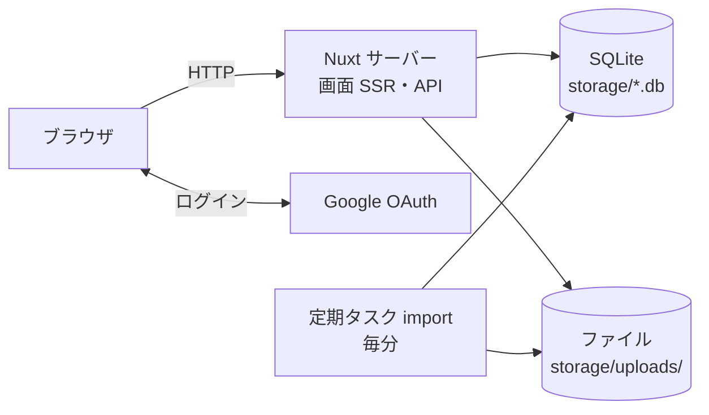

# 技術概要

Carble（このリポジトリ）の技術的な全体像。画面ごとの仕様は [product-spec/](../product-spec/README.md)、テーブルの説明は [データモデル](../product-spec/info/data-model.md) を参照。

## ページ構成

| ページ | 内容 |
|---|---|
| このページ | 全体像・技術スタック・ディレクトリ構成・画面と API・認証・データの流れ |
| [development.md](development.md) | 開発環境・よく使うコマンド・DB のマイグレーション・CLI・ブランチ |

## 全体像

1 つの Node.js のサーバー（Nuxt）が画面と API を返す。DB は SQLite のファイル、画像とインポートのファイルはサーバーのディスクに置く。本番は `Dockerfile` の `app` ステージのイメージで動かし、`/carble/storage` をボリュームにする。



| 要素 | 役割 |
|---|---|
| Nuxt サーバー | 画面はサーバーで HTML を作って返し（SSR）、ブラウザでハイドレーションする。API は Nitro（Nuxt に含まれるサーバーの土台）で動く |
| 定期タスク `import` | Nuxt サーバーの中で毎分動き、インポートを 1 件ずつ取り込む（[インポートの処理](#インポートの処理)） |
| SQLite | すべてのデータ（ユーザー・ログイン状態・プロジェクト・カード・インポートの記録）。libsql のクライアントで開く（[packages/db/lib/index.ts](../../packages/db/lib/index.ts) の `connect`）。ロックを取れないと待たずに失敗する（[ISSUES.md](../ISSUES.md)「同時に保存すると失敗し、DB がロックされたままになることがある」）。E2E テストのアプリだけ、環境変数 `CARBLE_E2E=1` で、失敗しないよう手を入れた接続（`packages/db/lib/e2e.ts`）を使う |
| `storage/uploads/` | 画像（`public/images/`）、縮小画像（`public/thumbs/`）、取り込み待ちのファイル（`imports/`） |
| Google OAuth | ログインの手段。これ以外のログイン方法は無い |

サイト全体に Basic 認証をかけることもできる（`NUXT_BASIC_AUTH_USER`・`NUXT_BASIC_AUTH_PASSWORD`。[非機能要件](../product-spec/features/non-functional.md)）。

## 技術スタック

| 分類 | 使っているもの |
|---|---|
| 言語・実行環境 | TypeScript、Node.js（Docker では `node:lts-slim`） |
| フレームワーク | Nuxt 3（3.19）、Vue 3（3.5）。サーバー側は Nitro |
| 画面 | Nuxt UI v2（2.22。Tailwind CSS を含む）、VueUse、SortableJS（並び替え）、Floating UI |
| アイコン | Iconify の Material Symbols Light・Logos |
| 入力検証 | Zod 4（エラーメッセージは日本語。`plugins/zod.ts`）、drizzle-zod（テーブル定義から Zod のスキーマを作る） |
| 認証 | Better Auth 1.4（Google OAuth、username プラグイン） |
| DB アクセス | Drizzle ORM 0.44、drizzle-kit（マイグレーション）、libsql（SQLite） |
| ファイル | SheetJS（xlsx・csv の読み書き）、unzipper・fflate（zip）、sharp（縮小画像）、busboy（アップロードの受け取り）、file-type（形式の判定） |
| QR コード | qrcode（印刷ビューで作る）、barcode-detector（スキャンで読む） |
| パッケージ管理 | pnpm（workspace のモノレポ） |
| lint | ESLint 9（`@nuxt/eslint`） |

## ディレクトリ構成

| パス | 内容 |
|---|---|
| `packages/app/` | アプリ（Nuxt）。パッケージ名 `@carble/app` |
| `packages/app/pages/` | 画面。ファイルの置き場所がそのまま URL になる（[画面](#画面)） |
| `packages/app/components/` | 画面の部品。画面ごとのものは `TableView/`・`CardView/`・`GridView/`・`PrintView/`・`ProjectIndex/`・`ProjectSettings/` にまとめる |
| `packages/app/composables/` | データの取得・保存と画面の状態（`card.ts`・`project.ts`・`gridView.ts`・`printView.ts` など） |
| `packages/app/middleware/` | 画面を移るたびに動く処理（`auth.global.ts`: ログインの確認） |
| `packages/app/plugins/` | 起動時の設定（Zod の日本語化、barcode-detector の読み込み） |
| `packages/app/server/api/` | API。`projects/index.post.ts` なら `POST /api/projects`（[API](#api)） |
| `packages/app/server/routes/` | `/api` 以外のサーバーの経路（画像の配信） |
| `packages/app/server/middleware/` | すべてのリクエストの前に動く処理（[サーバーのミドルウェア](#サーバーのミドルウェア)） |
| `packages/app/server/tasks/` | 定期タスク（`import.ts`） |
| `packages/app/server/utils/` | サーバー側の共通処理（DB 接続、Better Auth の設定、URL からプロジェクト・カード・項目を引く処理、印刷のレイアウトの定義など） |
| `packages/db/` | テーブル定義（`lib/schema/`）とマイグレーション（`migrations/`）。パッケージ名 `@carble/db`。アプリと CLI が使う |
| `packages/cli/` | 管理用のコマンド（[development.md](development.md#cli)）。パッケージ名 `@carble/cli` |
| `auth.ts` | Better Auth のテーブル定義を作り直すときだけ使う設定（`pnpm auth:generate`）。アプリの設定は `packages/app/server/utils/auth.ts` |
| `storage/` | 手元で動かすときの DB とファイル（git 管理外） |
| `Dockerfile`・`run.sh`・`docker-compose.yml` | 本番のイメージと、手元での起動 |
| `docs/` | 技術の説明（`architecture/`）・仕様（`product-spec/`）・既知の問題（`ISSUES.md`）・進行中の計画（`plans/`） |

## 画面

| パス | ファイル（`packages/app/pages/`） | 画面 |
|---|---|---|
| `/` | `index.vue` | [プロジェクト一覧](../product-spec/pages/project-list.md) |
| `/login` | `login.vue` | [ログイン](../product-spec/pages/login.md) |
| `/users/new` | `users/new.vue` | [ユーザー登録](../product-spec/pages/user-register.md) |
| `/users/edit` | `users/edit.vue` | [設定（ユーザー）](../product-spec/pages/user-settings.md) |
| `/projects/:projectId` | `projects/[projectId].vue` | [テーブルビュー](../product-spec/pages/table-view.md) |
| `/projects/:projectId/grid` | `projects/[projectId]/grid.vue` | [グリッドビュー](../product-spec/pages/grid-view.md) |
| `/projects/:projectId/print` | `projects/[projectId]/print.vue` | [カード印刷ビュー](../product-spec/pages/print-view.md)（全カード） |
| `/projects/:projectId/cards/:cardId` | `projects/[projectId]/cards/[cardId]/index.vue` | [カード入力ビュー](../product-spec/pages/card-view.md) |
| `/projects/:projectId/cards/:cardId/print` | `projects/[projectId]/cards/[cardId]/print.vue` | [カード印刷ビュー](../product-spec/pages/print-view.md)（1 枚） |
| `/projects/:projectId/settings` 以下 | `projects/[projectId]/settings.vue`（タブ）と `settings/index.vue`・`import.vue`・`users.vue`・`delete.vue` | [プロジェクト設定](../product-spec/pages/project-settings.md) |

## API

`/api/projects/:projectId` 以下は、ログインしていてそのプロジェクトのメンバー（招待中を除く）でなければ 404 になる（[サーバーのミドルウェア](#サーバーのミドルウェア)）。「オーナーのみ」の API は、ハンドラーの中でも確かめる。

| メソッドとパス | 内容 |
|---|---|
| `GET /api/health` | 稼働の確認。Basic 認証をかけない |
| `/api/auth/*` | Better Auth（ログイン・ログアウト・セッション・ユーザーIDの登録・ユーザーの削除） |
| `GET /api/print_layouts`、`GET /api/print_layouts/:layoutId` | 印刷のレイアウトの定義（サーバーに固定で持つ） |
| `GET /api/projects` | 自分のプロジェクトの一覧。`status=invited` で招待を受けているもの |
| `POST /api/projects` | プロジェクトを作る。自分をオーナーにする。`fields: true` なら初期の項目（みだし・メモ）も作る（ファイルからインポートするときは作らない） |
| `GET`・`PUT`・`DELETE /api/projects/:projectId` | プロジェクトの取得・名前の変更・削除（削除はオーナーのみ。画像のファイルも消す） |
| `GET /api/projects/:projectId/export` | エクスポート（zip を返す） |
| `GET /api/projects/:projectId/cards` | カードの一覧。`q`（検索）・`sort`・`direction` |
| `POST /api/projects/:projectId/cards` | カードを追加する。`nextToId` で位置を指定。スキャンでは画像と一緒に送る（multipart） |
| `PUT /api/projects/:projectId/cards` | カードの並び順を変える |
| `DELETE /api/projects/:projectId/cards` | カードをまとめて削除する |
| `POST /api/projects/:projectId/cards/duplicate` | カードを複製する（同じプロジェクト・別のプロジェクト・新しいプロジェクト） |
| `GET`・`DELETE /api/projects/:projectId/cards/:cardId` | カードの取得・削除 |
| `PUT /api/projects/:projectId/cards/:cardId/fields/:fieldId` | 値を保存する |
| `POST /api/projects/:projectId/cards/:cardId/images` | 画像を追加する |
| `DELETE /api/projects/:projectId/cards/:cardId/images/:imageId` | 画像を削除する |
| `POST /api/projects/:projectId/fields` | 項目を追加する（末尾） |
| `PUT /api/projects/:projectId/fields` | 項目の並び順を変える（全項目をまとめて送る） |
| `PUT`・`DELETE /api/projects/:projectId/fields/:fieldId` | 項目名・表示／非表示の変更、項目の削除 |
| `GET /api/projects/:projectId/imports` | インポートの一覧（状態・ページで絞り込める） |
| `POST /api/projects/:projectId/imports` | ファイルを受け取り、インポートを登録する（オーナーのみ） |
| `PUT /api/projects/:projectId/imports/:importId` | インポートの結果を知らせたことを記録する |
| `GET /api/projects/:projectId/users` | メンバーの一覧（招待中を含むのはオーナーのときだけ） |
| `POST /api/projects/:projectId/users` | ユーザーを招待する（オーナーのみ） |
| `PUT /api/projects/:projectId/users/:userId` | 自分への招待を承認する |
| `DELETE /api/projects/:projectId/users/:userId` | メンバーを外す（オーナー）、自分への招待を拒否する |
| `GET /uploads/images/:filename`、`GET /uploads/thumbs/:filename` | 画像・縮小画像を返す。その画像のプロジェクトのメンバーだけ。縮小画像は初めて求められたときに作る |

## サーバーのミドルウェア

`packages/app/server/middleware/` のファイルを名前の順に、画面・API・画像のすべてのリクエストの前に動かす。

| ファイル | 内容 |
|---|---|
| `1.db.ts` | DB に接続する（まだ接続していなければ） |
| `2.basicAuth.ts` | Basic 認証。ユーザー名とパスワードの両方を設定したときだけ。`/api/health` は除く |
| `3.projectAuth.ts` | パスに `/projects/<数字>` を含むとき、ログインしていなければ 401、メンバーでなければ 404。自分への招待を承認・拒否する API だけは招待中でも通す |
| `4.checkIsImporting.ts` | パスに `/projects/<数字>/` を含むとき、そのプロジェクトがインポートを待っている・取り込んでいる間は 409。`/imports` を含むパスは除く |

`3.projectAuth.ts`・`4.checkIsImporting.ts` は画面のパスにも当たる。未ログインの 401 は、エラー画面を描く途中で画面のミドルウェアがログイン画面へ転送するので表に出ない。インポート中の 409 はエラー画面になる（[ISSUES.md](../ISSUES.md#インポート中にプロジェクトの画面を直接開くとエラー画面になる)）。

## 認証

```
ブラウザ → /login →「Google でログイン」→ Google OAuth → /api/auth/callback/google（Better Auth）→ セッションの Cookie → /
```

- Better Auth の設定は `packages/app/server/utils/auth.ts`。DB は Drizzle のアダプター（テーブル名は複数形）。ユーザーID（username）は英数字・`_`・`-` だけ。ユーザーの削除を有効にしている
- ログイン状態は `sessions` テーブルと、Cookie `better-auth.session_token`（トークンに HMAC-SHA256 の署名を付けたもの。鍵は `BETTER_AUTH_SECRET`）で持つ
- 画面のミドルウェア `auth.global.ts` が、画面を移るたびにセッションを確かめる

| 状態 | 行き先 |
|---|---|
| ログイン画面 | 常に表示する |
| ログインしていない | `/login` |
| ログインしているがユーザーIDが無い | `/users/new` |
| ログインしていてユーザーIDがある | そのまま表示する |

- API 側は `useSessionUser()`（`server/utils/auth.ts`）でログインを確かめ、無ければ 401
- 権限（オーナー・編集者・招待中）は `usersToProjects` の `role`・`status` で表す（[ロールと権限](../product-spec/features/roles.md)、[データモデル](../product-spec/info/data-model.md#ロールの表し方)）

## データの流れ

- 画面は composables の中で `useFetch` / `useAsyncData` を使って API から読み、`$fetch` で書く。読んだデータはキー（例: プロジェクトのカード一覧）ごとに Nuxt が持ち、書いた後は `refreshNuxtData` で読み直す
- カード入力ビューの値は、入力が止まって 1 秒たつと保存する（`composables/card.ts` の `watchDebounced`）。プロジェクト名も同じく 1 秒後に保存する
- API の受け取る値は Zod で検証する。テーブル定義から drizzle-zod でスキーマを作り、画面とサーバーで同じ形を使う
- グリッドビューの選択・表示設定、カード印刷ビューの設定は、サーバーに保存せず `useState`（ブラウザのメモリ）に持つ。ブラウザを再読み込みすると初期値に戻る
- テーブルビュー・グリッドビュー・カード入力ビューの保存の状態のアイコン（`StatusIcon.vue`）は、`useMultiAsyncDataStatus` で複数の保存処理の状態をまとめて表示する

## インポートの処理

1. 画面からファイルをアップロードすると、`POST /api/projects/:projectId/imports` が `storage/uploads/imports/` に置き、状態 `OPEN` で登録する
2. 定期タスク `import`（`packages/app/server/tasks/import.ts`。`nuxt.config.ts` の `scheduledTasks` で毎分）が、全プロジェクトを通じていちばん古い `OPEN` を 1 件取り、`IN_PROGRESS` にする。前の処理が終わるまで次は始めない
3. zip なら OS の一時フォルダに展開し、中の xlsx・csv を SheetJS で読む
4. 行を確かめ、誤りがあれば `FORMAT_ERROR` にしてエラーの内容を `message` に残す
5. 項目・カード・値・画像を登録し、`DONE` にする。途中で予期しないエラーが起きたら `SYSTEM_ERROR`
6. 終わったら（エラーでも）アップロードしたファイルと展開したフォルダを消す
7. テーブルビューが結果を表示し、`PUT .../imports/:importId` で知らせたことを記録する

取り込みの規則とエラーメッセージは [インポート・エクスポート](../product-spec/features/import-export.md)。インポートの状態は [データモデル](../product-spec/info/data-model.md#インポートの状態)。

## 経緯

- この文書は、リポジトリの直下に仮で置いていた `ARCHITECTURE.md` の内容を、2026-10-27 時点のコードに合わせて書き直したもの（`ARCHITECTURE.md` は廃止）
