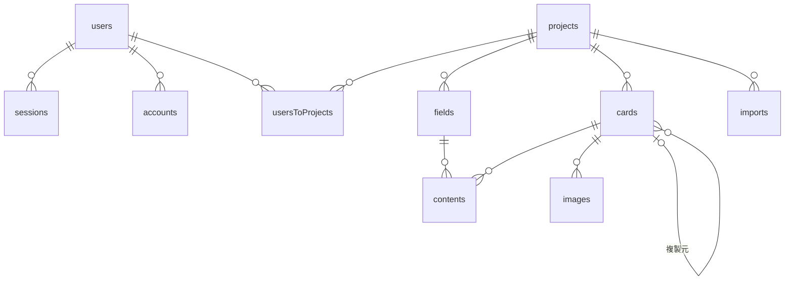

# データモデル

仕様を読むための参考情報。テーブルの定義は [packages/db/lib/schema/](../../../packages/db/lib/schema/) にある（Drizzle ORM、SQLite）。

## ER 図



## テーブル

| テーブル | 内容 | 主な列 |
|---|---|---|
| users | ユーザー（Better Auth が管理） | `id`、`name`、`email`（一意）、`username`（ユーザーID。一意。登録するまでは空） |
| sessions | ログイン状態（Better Auth） | `token`、`expiresAt`、`userId` |
| accounts | Google アカウントとの対応（Better Auth） | `providerId`、`accountId`、`userId` |
| verifications | ログインの手続き中に使う一時的な値（Better Auth） | `identifier`、`value`、`expiresAt` |
| usersToProjects | ユーザーとプロジェクトの関係 | `userId` と `projectId` の組が主キー、`role`（`owner` か空）、`status`（`invited` か空）、`createdAt`（ユーザー管理の並び順） |
| projects | プロジェクト | `id`、`name`、`updatedAt`（一覧の最終更新日時） |
| fields | 項目 | `id`（システム全体の連番）、`projectId`、`name`、`isVisible`（既定は表示）、`order` |
| cards | カード | `projectId` と `id` の組が主キー（ID はプロジェクトごと）、`order`、`originalProjectId`・`originalCardId`（複製元） |
| contents | 値 | `projectId`・`cardId`・`fieldId` の組が主キー、`body` |
| images | 画像 | `id`（システム全体の連番）、`projectId`・`cardId`、`filename`（`storage/uploads/public/images/` のファイル名。一意。縮小した画像は `storage/uploads/public/thumbs/` の「`filename`.webp」）、`createdAt`（カードの中の画像の並び順） |
| imports | インポート | `id`、`projectId`、`status`（下記）、`filename`（`storage/uploads/imports/` のファイル名）、`originalFilename`、`message`（エラーの内容）、`notifiedAt`（テーブルビューで結果を知らせた日時）、`options.update`（上書きするか）、`createdAt`（インポート日時） |

## ロールの表し方

| ロール | `role` | `status` |
|---|---|---|
| オーナー | `owner` | 空 |
| 編集者 | 空 | 空 |
| 招待中 | 空 | `invited` |

## インポートの状態

```
OPEN（未処理） → IN_PROGRESS（インポート中） → DONE（インポート済）
                                         → FORMAT_ERROR（フォーマットエラー）
                                         → SYSTEM_ERROR（システムエラー）
```

`ABORT`（中止）は定義されていて、インポート履歴の表示（「中止」）もあるが、この状態にする処理は無い。

## 削除したときの連動

テーブルの外部キーの `onDelete: 'cascade'` で消えるものと、API の処理でファイルを消すものがある。

- プロジェクトを削除すると、項目・カード・値・画像・インポート・ユーザーとの関係も消える。画像のファイル（縮小した画像を含む）も消す
- カードを削除すると、値と画像も消える。画像のファイル（縮小した画像を含む）も消す
  - 複製先のカードは残り、複製元の記録（`originalProjectId`・`originalCardId`）が空になる
- 画像を削除すると、画像のファイル（縮小した画像を含む）も消す
- 項目を削除すると、その項目の値も消える
- インポートで画像を置き換えると、元の画像のファイルは消すが、縮小した画像のファイルは残る
- ユーザーを削除すると、ログイン状態・Google アカウントとの対応・プロジェクトとの関係は消えるが、オーナーだったプロジェクトは残る（[ISSUES.md](../../ISSUES.md#ユーザーを削除してもオーナーのプロジェクトが残る)）
