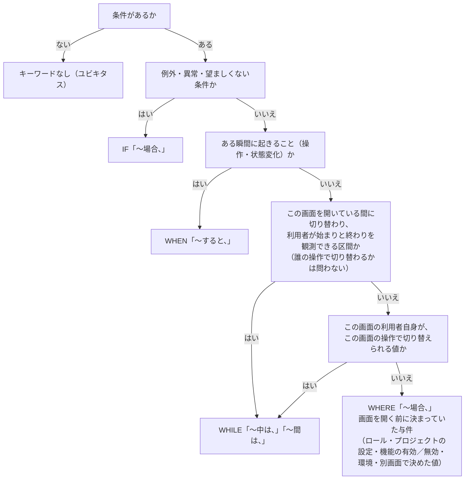

# 外部仕様の記載ルール

仕様書（`docs/product-spec/`）でユーザーストーリー・外部仕様を記述する際の共通ルール。

## ファイル構成

- 仕様は次の3つのディレクトリに分けて置く

  | ディレクトリ | 置くもの |
  |---|---|
  | `pages/` | 画面単位の仕様。1画面1ファイル |
  | `features/` | 画面をまたぐ機能（インポート・エクスポートなど）、共通事項（ロールと権限、画面共通など）、非機能要件 |
  | `info/` | 理解の助けとなる参考情報（用語・利用フロー・データモデルなど）。仕様ではないため、下記の章立てに従わなくてよい |

- `README.md` にはメタ情報（構成・記載ルール・出典・仕様書一覧）だけを書き、仕様や参考情報は書かない
- 別のディレクトリのファイルへは相対パスでリンクする（例: `pages/` から `../features/roles.md`）
- 実装の不具合や、テストでだけ通る経路の挙動など、仕様書に書かない既知の問題は `docs/ISSUES.md` に書き、仕様書の「実装との乖離」からリンクする

## 反映する課題

- ユーザーストーリー・外部仕様（What）・変更履歴には、**解決済みの課題**（課題管理で完了し、実装されたもの）だけを反映する
- オープンの課題（保留・レビュー中・対応中など）は検討中のため、どこにも反映しない（「未対応の課題」にも書かない）
- 完了していても、要望が実装されていない課題（解決状況が「不完全」「重複」「不実行」のもの、合意したが未実装のもの、対応不要と判断したもの）は、ユーザーストーリー・外部仕様の根拠にせず、「未対応の課題」に書く

## 章立て

`pages/` と `features/` は、画面・機能単位で1ファイル。次の章立てで書く。

```
# <機能名>

## ユーザーストーリー（Why）
## 外部仕様（What）
## 補足情報
```

## ユーザーストーリー（Why）

- その機能が「なぜ」存在するのか、利用者の視点で書く
- 基本形は「**［（文脈）において、］（誰）が、（機能）することで、（理由）したい**」
  - 文脈（前提・状況）は必要な場合のみ補う
  - 例: 「紙の資料を調べながら記録するとき、研究者が、カードを入力したその場で次のカードを追加することで、手を止めずに記録を続けたい」
  - 例: 「オーナーが、インポートでの上書きを明示的に選ぶことで、意図せずカードの内容を失わないようにしたい」
- 利用者は具体的な役割で書く（「ユーザー」ではなく「オーナー」「編集者」「招待されたユーザー」など。ロールは [features/roles.md](features/roles.md) を参照）
- 仕様（What）や操作手順そのものは書かない。あくまで動機・目的にとどめる
- 箇条書き。粒度が異なるストーリーはネストで階層化してよい
- 各ストーリーの末尾に出典を括弧で、前に空白を入れずに書く。推測と課題で裏付けのあるストーリーを見分けられるようにするため
  - 課題番号の注記は、括弧が全角でも半角でもよく、複数の課題番号と「理由は推測」の区切りは「、」でもカンマでもよい（`(CESCHI-1234, CESCHI-2345)` など）。括弧の左右はそろえる。推測の注記は下の形のとおりに書く
  - `（CESCHI-1234）`: 課題で機能の要望が確かめられ、目的が課題に書かれているか、課題に書かれていなくても課題の内容から目的を妥当と判断した。複数なら `（CESCHI-1234、CESCHI-2345）`
  - `（CESCHI-1234、理由は推測）`: 課題で機能の要望は確かめられるが、「（理由）したい」の部分は課題から判断できないか、課題に書かれた目的と違う。複数なら `（CESCHI-1234、CESCHI-2345、理由は推測）`
  - `（推測、確信度: 高|中|低）`（例 `（推測、確信度: 中）`）: 該当する課題が見つからない（出典の Confluence にだけある場合を含む）か、ストーリーの主語・動機が機能の実態と食い違う。確信度は、仕様・コードから見てその動機がどれだけ確からしいか
  - 課題番号はリンクにしない（テスト設計の検査が決まった形で読むため）。課題は `https://kinako.atlassian.net/browse/<課題番号>` で開ける
  - 子を持つ箇条書きは、それ自体がストーリーなら付け、文脈の見出し（「紙の資料を調べながら記録するとき、」など）なら付けない
  - この意味の注記はユーザーストーリー節に限る。外部仕様の文末の課題番号は、その仕様を入れた課題を示すだけで、目的の裏付けを意味しない
  - 末尾の注記は、テスト設計の検査（`tests/e2e/scripts/lib/test-design.mjs`）が [docs/test-design](../test-design/README.md) の表と照合する前に取り除く。注記だけを変えても表の引用を直す必要は無い。子を持たない箇条書きの注記の付け忘れと、注記の書式の誤りは検査（下の「テストとの対応」）が見つける

## 外部仕様（What）

- 仕様書の What を整理して書く
- **EARS記法**の箇条書きで記述する（下記「EARS記法のルール」を参照）
- **ユーザー視点で書く**。実装の詳細（クラス名・オプション名・アニメーション種別・レイアウトの寸法など）はソースコードで参照し、外部仕様には書かない
  - NG例: 「`modal-open` クラスを付ける」「`weight` の昇順に並べる」「表の幅は 80% にする」
  - OK例: 「確認のダイアログを表示する」「並び替えた順に表示する」
  - 例外: それがなければ仕様として成り立たない内部詳細は記載してよい（例: エクスポートするファイルの名前、インポートで特別に扱う列の名前など）
- 利用者が画面で体験する数値（自動保存までの待ち時間、ユーザーIDの文字数、インポートを処理する間隔、1ページに表示する件数など）は、仕様として記載してよい
  - 環境ごとに設定で変わる値（Basic 認証の有無、アップロードできるファイルの大きさなど）は、設定の場所を示し、値は「既定値」または「本番環境の値」として書く

## 補足情報

- **実装との乖離**: 仕様と実装に乖離があればその内容を記載する。未調査の場合は「未調査」と記載し、ソースコード突き合わせて乖離がないことが確認できた場合のみ「無し」と記載する。
  - 書くのは、画面の説明文と実際の動作の食い違い、設定で無効になっている機能など、仕様と実装そのもののずれに限る
  - 課題として挙がったが対応していない要望は、乖離ではなく「未対応の課題」に書く
  - セキュリティの脆弱性は書かない（`docs/ISSUES.md` にも書かず、課題管理で別に扱う）
  - `docs/ISSUES.md` に載せている問題は、その節へリンクする
- **関連機能**: 他の仕様書へのリンク
- **変更履歴**: 仕様に**実際に反映された**変更内容を「`- [課題番号](リンク) 変更内容`」形式の箇条書きで、新しい順（降順、最新が上）に記載する
  - すべての課題が網羅されていることは保証しない。特筆すべき変更内容がない課題は省略してよい
  - 仕様に反映されていない課題（保留・未対応・対応不要と判断・未実装のアイデア）は変更履歴に書かず、「未対応の課題」に記載する
- **未対応の課題**（該当する課題がある場合のみ設ける）: 課題として認識されているが仕様・実装に反映されていないもの（保留・未対応・対応不要と判断された案・別の管理表の未実装アイデア等）を、「`- [課題番号](リンク) 内容（状態）`」形式の箇条書きで記載する
  - 「現在の仕様がなぜそうなっているか（何を検討して採用しなかったか）」の文脈を残す目的で書く
  - 状態が「実装済みかどうか不明」な課題は変更履歴側に残してよい。ここには**実装されていないことが明確な**課題のみを書く

## EARS記法のルール

外部仕様（What）は EARS (Easy Approach to Requirements Syntax) 記法の箇条書きで書く。

| キーワード | 用途 | 日本語表現 |
|---|---|---|
| （なし） | 常に成り立つ要件（ユビキタス） | 「〜する」 |
| WHEN | イベント駆動（操作・状態変化が起きたとき） | 「〜すると、」 |
| WHILE | 状態駆動（利用者が観測できる区間・自分の画面の操作で切り替える値） | 「〜中は、」「〜間は、」 |
| IF | 例外・異常・望ましくない条件（正常系の分岐には使わない） | 「〜場合、」 |
| WHERE | 与件（ロール・プロジェクトの設定・機能の有効／無効・環境・画面を開く前に別画面で決まっていた値） | 「〜が有効な場合、」「〜環境の場合、」「〜場合、」 |

`WHILE` と `WHERE` は境目が紛らわしいため、判定は「[WHILE と WHERE の使い分け](#while-と-where-の使い分け)」に従う。`WHERE` は標準 EARS より広い範囲で使う。

### 書き方

- 箇条書きで書き、主語「システムは」は省略する
- キーワードは `**WHEN**` のように太字にする
- 日本語として自然につながる接続にする
  - 「WHEN 〜する、…」ではなく「WHEN 〜すると、…」
- イベントか・状態か・条件か・環境かを意識してキーワードを選ぶ
  - 例: スマホ幅はイベントではなく環境コンテキストなので `WHERE`（`WHEN` ではない）
  - 例: 「プロジェクトのオーナーの場合に表示されるタブ」は `WHERE`、「常に表示されるボタン」はキーワードなし
- ある操作に後続・付随する仕様は**ネスト**して表現する
  - 例: 「削除を押すと確認のダイアログを表示する」→ その下に「確認後、カードを削除する」をネスト
- 節（キーワードから、つなぎの語まで）は、テスト設計の検査が機械で切り分ける。次の形で書く（合わない文は、検査が「節に分けられない仕様の文」として知らせる）
  - 節の終わりのつなぎの語は、`WHEN` が「〜と、」、`WHILE` が「〜中は、」「〜間は、」、`IF`・`WHERE` が「〜場合、」「〜場合も、」「〜場合（補足）、」
  - 節の中に読点を置かない（例: 「ID と、名前を押すと、」は「ID・名前を押すと、」にする）
  - 1 つの節に条件は 1 つ、1 文に振る舞いは 1 つにし、複数あれば入れ子や別の文に分ける
  - キーワードの直後に空白を置く
  - 句点の後に続く 2 つ目の文の頭にキーワードを置かない（別の箇条書きにする）
  - 検査に合わせて文を直すときも、文の意味（条件・範囲）を変えない
- 操作の順序で結果が変わる振る舞いは、状態に名前を付けて書く（`WHILE` の区間か、番号付きの状態）。名前が無いと、テスト設計は状態遷移の表を作れず仕様の不足になる（[テスト設計の「状態遷移の表」](../test-design/README.md#状態遷移の表)）
- 上限・下限・期限など値・範囲を書くときは、超えたとき（下回ったとき）の結果も書く。境界ちょうどがどちらに入るか紛らわしい表現には、境界ちょうどを含むかを書く。書いていないと、テスト設計は境界の外側を確かめられず仕様の不足になる（[テスト設計の「境界値」](../test-design/README.md#境界値)）

### WHILE と WHERE の使い分け

**WHILE は利用者が観測可能な区間、WHERE は与件（すでに決まっていること）の分岐**に使う。語尾も揃える（WHILE:「〜中は、」「〜間は、」／ WHERE:「〜場合、」）。

判定フロー。**条件 1 つごとに**上から順に問い、最初に当たったキーワードを使う。1 文に条件が複数あるときは条件ごとに判定し、**入れ子**で書く（後述）。「画面」は、画面を持たない仕様（インポートの処理・API など）では「一回の処理」と読み替える。



Q4 は Q3 に含まれる場合が多いが、「「同じIDのカードを上書きする」をチェックしている」のような**入力値による分岐**は区間として意識されにくく `WHERE` に流れやすいため、問いとして分けている。どちらで当たっても結果は `WHILE`。

- **WHILE（区間）**: その仕様を書いている画面の利用者が、始まりと終わりを観測できる区間。保存中・インポート中など
- **WHERE（与件）**: その仕様を書いている画面の利用者から見て、すでに決まっているもの（ロール・プロジェクトの設定・機能の有効／無効・環境・画面を開く前に別の画面で決まっていた内容）

区間ではない「値による分岐」は、「**その画面の利用者自身が、その画面の操作で切り替えられるか**」で決める。

- 切り替えられる → `WHILE`。例: プロジェクト設定の仕様「**WHILE** 「同じIDのカードを上書きする」をチェックしている間は、ID 列のカードの内容を上書きする」（オーナーがその画面で切り替える）
- 切り替えられない → `WHERE`。例: テーブルビューの仕様「**WHERE** 非表示にした項目の場合、列を表示しない」（項目の編集で別に決めた内容）

同じ条件でも、**どの画面の仕様かでキーワードが変わる**。これは矛盾ではなく、基準にしている画面が違うため。

判定の補足。

- **他の利用者の操作による変化は、時点で分ける**。画面を開いている間に他の利用者の操作で切り替わり、画面に反映されるものは、自身が切り替えられなくても区間として `WHILE`。画面を開く前に別の画面で決まっていた値（ロール・項目の表示／非表示）は与件として `WHERE`
- **画面を持たない仕様**（インポートの処理・API など）は、「一回の処理の中で切り替えられるか」で同じように判定する
- **時間で変わる条件**（インポートの完了など）も Q3 で判定する。画面を開いている間に切り替わりを観測できない（次に開いたときには変わっている）なら与件として `WHERE`、画面を開いている間に完了して表示が切り替わるなら区間として `WHILE`
- **IF は例外・異常・望ましくない条件にのみ使う**。同じ「〜場合、」でも、正常系の分岐は `WHERE`（上記にあたるものは `WHILE`）

WHEN と並べると分かりやすい。**WHEN が点、WHILE が区間、WHERE が面**で、同じ事象でも切り口で変わる。

| 書きたいこと | キーワード | 例 |
|---|---|---|
| 点（その瞬間に起きること） | `WHEN` | 「追加すると、」 |
| 区間（始まりと終わりがある状態） | `WHILE` | 「保存中は、」「チェックしている間は、」 |
| 面（すでに決まっている与件） | `WHERE` | 「オーナーの場合、」「スマホ幅の場合、」 |

- 3つが重なるときは**入れ子**にする。どれか1つへ無理に寄せない
  - 例: 「**WHERE** 既存のプロジェクトにインポートする場合、「同じIDのカードを上書きする」チェックを表示する」→ その下に「**WHILE** チェックしている間は、同じ ID のカードを上書きする」をネスト
- 既存の仕様書には、このルールと合わない記述が両方向に存在する。**遡及して一括修正はしない**。その箇所を触ったときに直す
  - `WHERE` → `WHILE`: 自分の画面の操作で切り替える入力フォーム内の分岐を `WHERE` で書いている
  - `WHILE` → `WHERE`: 画面を開く前に別の画面で決まっていた値による分岐を `WHILE` で書いている

#### 標準 EARS からのテーラリング（本プロジェクト向けの調整）

上記の `WHERE` の使い方は、標準の EARS とは範囲が異なる。

- 標準 EARS（Mavin ら, RE'09）の `WHERE` は**オプション機能**限定で、「その機能が製品に含まれている構成でのみ成立する要件」を指す。航空エンジンなど、出荷時の構成で可変点が固定される物理製品のプロダクトライン（製品系列）を前提にした用法
- 本プロジェクトは Web サービスで、利用者から見える可変点は出荷構成ではなく、**ロール・プロジェクトの設定・機能の有効／無効・環境・画面を開く前に別画面で決まっていた値**として実行時に決まる。そのため `WHERE` を**与件全般**へ広げて使う（本節の定義が本プロジェクトの基準）
- 結果、標準どおりなら状態駆動の `WHILE` で書く「画面を開く前に別の画面で決まっていた値による分岐」も、本プロジェクトでは `WHERE` になる。EARS の一般的な解説や生成AIの出力とは食い違う箇所なので、そのまま採用せず本節に合わせる。一方、画面を開いている間に切り替わる区間は標準どおり `WHILE` で、この点は標準と同じ

### 表との併用

- 表示条件が多数あり、表のほうが明らかに読みやすい箇所（例: インポートの結果の表示）は、EARS文に固執せず表を使ってよい

### E2E テストとの対応

キーワードは画面の E2E テスト（`tests/e2e/`）の構造と対応する。仕様から確認手順を起こすときの目安。

| キーワード | E2E での位置 |
|---|---|
| （なし） | 全ケース共通の assertion |
| WHEN | トリガー操作と直後の assertion |
| WHILE | テスト本文（区間に入る → 区間中を検証 → 抜ける） |
| IF | 異常の誘発。状態として仕込むものは fixture、操作で起こすものは本文 |
| WHERE | fixture・`test.use`・前提データ（与件を仕込む） |

- `WHERE` の数は fixture の組み合わせ次元（ケース数の掛け算）になり、`WHILE` は1ケース内の遷移で済む。書き分けはテストの実装コストに直結する

## テストとの対応

- ユーザーストーリーと外部仕様は E2E テストと連動させ、テスト項目の基礎にする。ユーザーストーリーから利用者の目的に沿ったシナリオを、外部仕様から操作・条件・期待結果を整理する
- 仕様とテストの間には [テスト設計](../test-design/README.md)（`docs/test-design/`）を置く。仕様の文をテスト設計の表の行（ルール）に対応させて ID を振り、テストはその ID をタグで示す
- 仕様を変えたら、同じパスのテスト設計も同じ変更で直す。仕様に書くか、テスト設計に書くかは、[テスト設計の「仕様とテスト設計の線引き」](../test-design/README.md#仕様とテスト設計の線引き)で決める
- 記述ルールのうち機械で確かめられるもの（ユーザーストーリーの出典注記・EARS の節）と、仕様・テスト設計・テストの対応は、検査で確かめる（`tests/e2e/` で `pnpm run check:test-design`。仕様書だけなら `node scripts/check-test-design.mjs --spec-only`）
